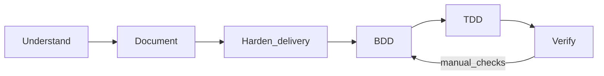

# DealerDesk — SDLC with AI

Simple delivery loop for this repository. AI agents speed up work; humans
remain accountable for what ships.

**BDD and TDD are mandatory.** No feature or behaviour change ships without
behaviour scenarios and test-first implementation.

## 1. Understand

- Read the C sources and `data/*.dat` before changing behaviour.
- Prefer code over diverging documentation (see `docs/SYSTEM.md`).
- Clarify ticket intent; if something is ambiguous, make a reasonable call and
  write it down in the change notes.

## 2. Document

- Record actual behaviour when it is not already captured.
- Keep project docs in English.
- Do not “fix” product behaviour in docs alone; change code when behaviour
  must change.

## 3. Harden delivery

- Improve how changes are built, tested, and checked (Makefile, tests, CI) as
  needed for safe change.
- Agent AI setup lives in the repo so the same constraints apply across tools
  and sessions. Canonical instructions: `AGENTS.md`. Tool entry points also
  point there (`CLAUDE.md`, `.github/copilot-instructions.md`,
  `.cursor/rules`, and any other agent that reads repo instruction files such
  as Copilot, Claude, Cursor, DeepSeek, Codex, Gemini, and similar).

## 4. BDD (Behaviour-Driven Development)

Required before writing production code for a change.

- Turn the ticket or bug into concrete behaviour scenarios (Given / When /
  Then, or equivalent acceptance examples).
- Cover happy path, edge cases that matter for money/totals, and regression
  for existing customer types (retail / trade) where pricing is involved.
- Scenarios are the shared language for humans and agents. Implementation
  starts only after the scenarios are written down in the repo (feature files
  or an agreed test description format).

## 5. TDD (Test-Driven Development)

Required for each behaviour unit the change touches.

1. **Red** — write an automated test that fails (or fails to compile) for the
   next scenario or unit.
2. **Green** — write the smallest production change that makes the test pass.
3. **Refactor** — clean up with tests still green.

Rules:

- No production behaviour without a failing test first.
- Prefer tests close to the logic under change (for example `calc_quote` and
  related pure logic before UI wiring).
- Keep existing dealership totals correct to the penny unless the ticket
  intentionally changes them.

## 6. Verify

- Run the full automated suite for the change.
- Always perform manual checks as well (build, smoke the menus that matter for
  the change, restore sample data if you mutated `data/`). Manual checks are
  part of every change; there is no separate checklist document.
- Prefer small, reviewable changes. Feature work (for example `TICKET-142.md`)
  goes through this loop, not around it.

## Roles

| Role | Responsibility |
|------|----------------|
| Agent | Draft scenarios (BDD), tests (TDD), and code; propose diffs |
| Human | Decide, review scenarios/tests, run manual checks, commit/push |

## Project conventions (summary)

- Docs, code comments, and commit messages: English.
- Do not invent code, features, or behaviour the ticket did not ask for.
- BDD then TDD on every behaviour change; skip neither.
